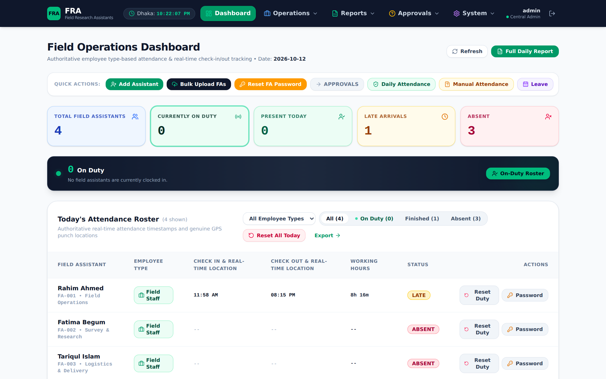
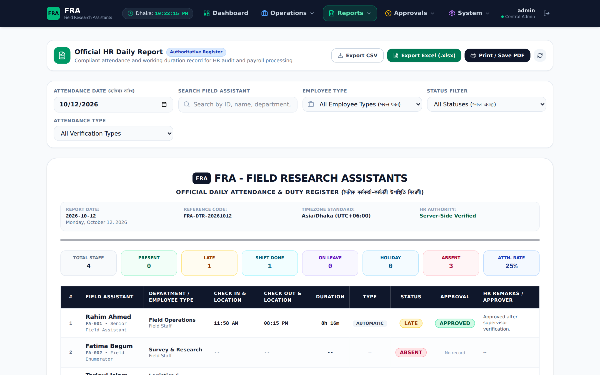
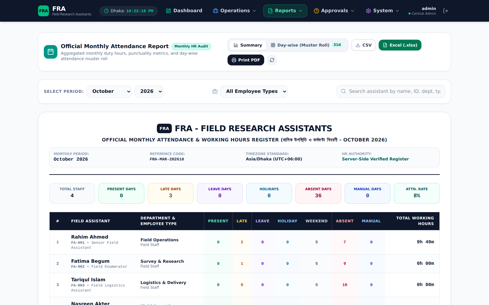
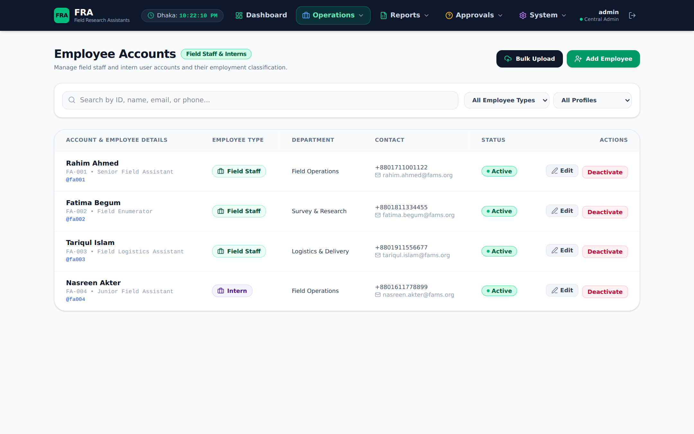
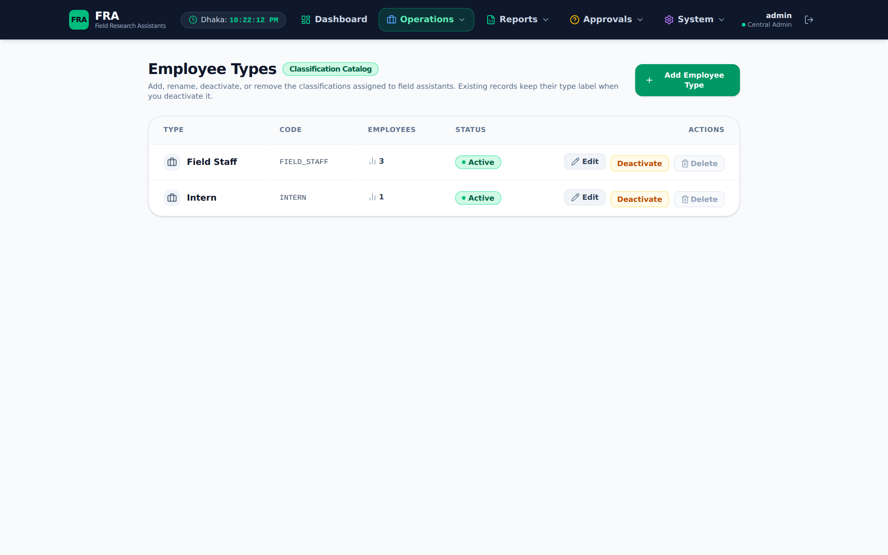
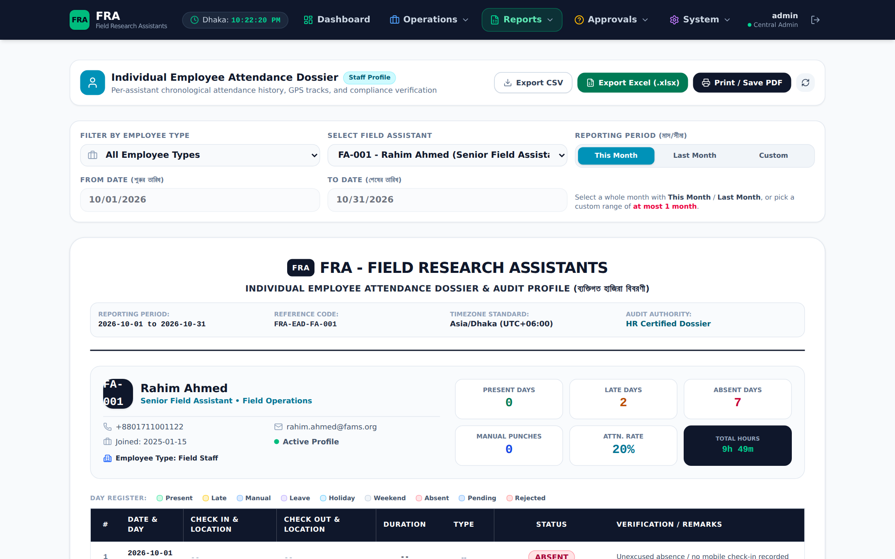
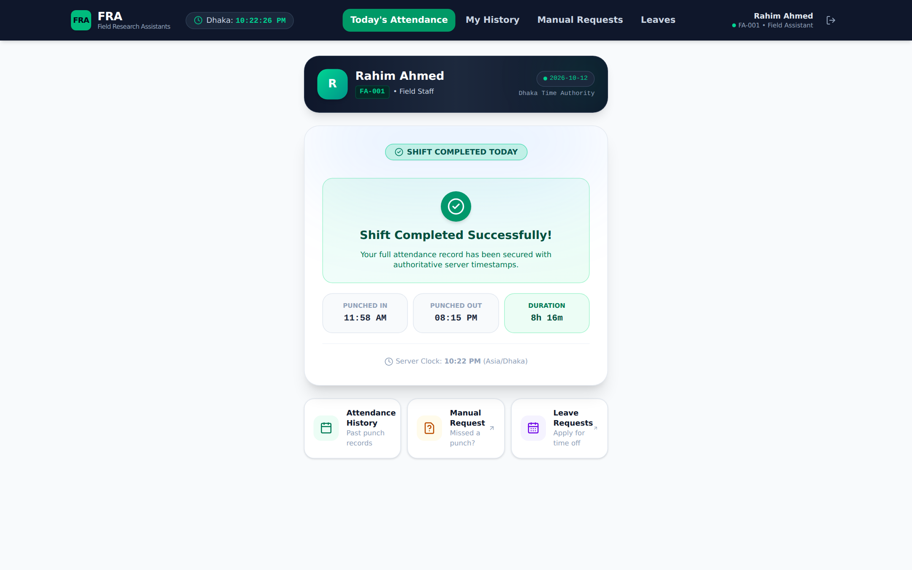

# FRA — Field Research Assistants

An enterprise-grade, mobile-first attendance management and verification platform engineered for Field Research Assistants (FRA) and central administrators.

---

## 🖼️ Screenshots

| Login | Admin Dashboard |
|---|---|
|  |  |

| Daily Attendance Register | Monthly Attendance Register |
|---|---|
|  |  |

| Field Assistant Management | Employee Type Catalogue |
|---|---|
|  |  |

| Individual Employee Dossier | Field Assistant Portal (Mobile-first) |
|---|---|
|  |  |

---

## 🚀 Key Highlights & Invariants

1. **Server-Side Timestamp Authority (`Asia/Dhaka` / UTC+6)**:
   - Device and client clocks are **never trusted**.
   - All check-in and check-out timestamps are stamped directly by the Django server in Bangladesh local time.
   - Mobile frontend displays live elapsed working duration synchronized to server clock delta.

2. **Concurrency & Race Condition Guard**:
   - Atomic transactions (`select_for_update()`) and database unique constraints (`employee_id, attendance_date`) prevent duplicate check-ins and check-outs under erratic field network conditions.

3. **Separation of Attendance Types**:
   - `AUTOMATIC`: Instant field check-ins with verified server time.
   - `MANUAL`: Formal exception request workflow submitted by assistants and reviewed/approved by administrators.

4. **Separate Admin Approval Queues**:
   - **Daily Attendance Approval** — duty-day sign-off so records count toward payroll.
   - **Manual Attendance Approval** — review of manual punch / correction requests.
   - **Leave Approval** — review of leave applications plus holiday management.
   - Each has its own dedicated page and quick action for admins.

5. **Immutable Audit Trail**:
   - Every state transition (check-in, check-out, manual requests, approvals, profile changes, data corrections) is logged into an append-only ledger capturing user, action, IP address, user-agent, and JSON state diffs.

6. **Soft Deactivation**:
   - Field assistants are deactivated rather than deleted, preserving 100% mathematical accuracy of past historical attendance reports.

7. **Admin-Managed Employee Types**:
   - Employee types are a DB-backed catalogue (create / rename / activate / deactivate), referenced by employees via a stable code. In-use types cannot be deleted, only deactivated.

---

## 🛠️ Technology Stack

* **Backend**: Django 5.1, Django REST Framework, SimpleJWT
* **Database**: PostgreSQL 16 (with connection pooling and ACID constraints)
* **Frontend**: React 18, TypeScript, Tailwind CSS, Vite, Lucide Icons
* **Reverse Proxy & WSGI**: Nginx + Gunicorn
* **Export Engine**: OpenPyXL (Excel `.xlsx`) and streaming CSV

---

## 🔑 Demo Access Credentials

Field Assistants sign in with **Employee ID + Password** (no PIN).

| Role | Employee ID / Username | Password | Purpose |
|---|---|---|---|
| **Administrator** | `admin` | `admin123` | Management, reports, approvals, audit trail, settings |
| **Field Assistant** | `FA-001` | `Fams@123` | Rahim Ahmed — Senior Field Assistant |
| **Field Assistant** | `FA-002` | `Fams@123` | Fatima Begum — Field Enumerator |
| **Field Assistant** | `FA-003` | `Fams@123` | Tariqul Islam — Field Logistics Assistant |
| **Field Assistant** | `FA-004` | `Fams@123` | Nasreen Akter — Junior Field Assistant (Intern) |

---

## 🏃 Quick Start & Verification

### 1. Run Health Check
```bash
/root/deploy/scripts/health_check.sh
```

### 2. Run Automated Pytest Suite
```bash
/root/backend/venv/bin/pytest /root/backend/tests
```

### 3. Automated Database Backup
```bash
/root/deploy/scripts/backup_db.sh
```

---

## 🌐 Endpoints & Web Portals

* **Web Application**: `https://fams.202.168.244.109.sslip.io/`
* **API Base URL**: `https://fams.202.168.244.109.sslip.io/api/v1/`
* **Django Admin**: `https://fams.202.168.244.109.sslip.io/django-admin/`
